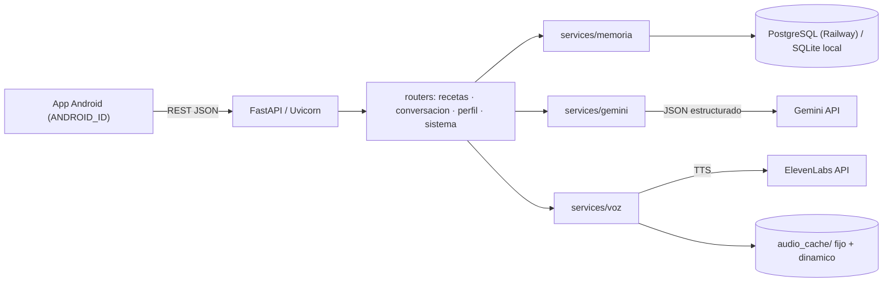

# Lyra API — Backend en la nube

Backend en **FastAPI + PostgreSQL** para *Lyra: Asistente de Cocina Humana y Accesible para Personas de la Tercera Edad*.
Lyra es una compañera de cocina empática con identidad culinaria tradicional mexicana: conversa con **Google Gemini**, habla con voz humana de **ElevenLabs** y recuerda con cariño lo que la persona le comparte.

## Arquitectura



```
backend/
├── app/
│   ├── main.py            # App, lifespan (tablas + siembra), CORS, routers
│   ├── config.py          # Variables de entorno (pydantic-settings)
│   ├── database.py        # Motor async; normaliza DATABASE_URL de Railway → asyncpg
│   ├── models.py          # Dispositivo, Receta, Ingrediente, Paso, HechoMemoria, Mensaje
│   ├── schemas.py         # Contratos Pydantic
│   ├── deps.py
│   ├── routers/           # recetas.py, conversacion.py, perfil.py, sistema.py (voz + salud)
│   ├── services/          # gemini.py, voz.py, memoria.py, prompts.py, texto.py
│   └── seed/              # recetas_data.py (20 recetas) + seeder.py
├── static/recetas/        # Imágenes servidas en /recetas/{archivo}
├── tests/test_api.py
├── Dockerfile · railway.json · Procfile · requirements.txt · .env.example
```

## Endpoints

| Método | Ruta | Descripción |
|---|---|---|
| GET | `/api/salud` | Healthcheck (Railway). 503 si la BD no responde |
| GET | `/api/recetas` | Listado de recetas |
| GET | `/api/recetas/{slug}` | Detalle: ingredientes (`base`/`salsa`/`servicio`) y pasos |
| GET | `/api/recetas/{slug}/pasos/{orden}/audio` | MP3 del paso (caché permanente) |
| POST | `/api/conversacion` | Pregunta a Lyra con perfil, historial y memoria |
| GET | `/api/perfil?dispositivo_id=...` | Perfil (lo registra si es nuevo) |
| PUT | `/api/perfil` | Actualización parcial del perfil, alergias y salud |
| DELETE | `/api/perfil/hechos/{id}?dispositivo_id=...` | "Olvidar" un recuerdo |
| POST | `/api/voz` | Texto → MP3 (`X-Audio-Cache`, `X-Audio-Url`) |
| GET | `/api/voz/audio/{hash}.mp3` | Audio en caché |
| POST | `/api/voz/precalentar` | Pre-genera frases frecuentes |
| GET | `/recetas/{archivo}` | Imágenes estáticas |

Documentación interactiva: `/docs`.

### Ejemplo: conversación

```http
POST /api/conversacion
{
  "dispositivo_id": "a1b2c3d4e5f6",
  "receta_titulo": "Chilaquiles verdes",
  "paso_texto": "Licuar la salsa",
  "pregunta": "Mi hijo Roberto viene el domingo, ¿le pongo menos chile?",
  "con_voz": true
}
```
```json
{
  "respuesta": "¡Qué gusto que venga Roberto! Si quiere que piquen menos, quítele las semillas al chile serrano o ponga sólo uno.",
  "hecho_guardado": "Su hijo Roberto la visita el domingo",
  "alerta_emergencia": false,
  "contacto_emergencia": null,
  "audio_url": "https://.../api/voz/audio/3f9a...e1.mp3",
  "fuente": "gemini"
}
```

`alerta_emergencia` usa un detector determinista (caídas, dolor, quemaduras, gas…) además de Gemini, para que la app muestre de forma fiable el botón **"Llamar a mi familiar"** con `contacto_emergencia`.

### Ejemplo: perfil

```http
PUT /api/perfil
{
  "dispositivo_id": "a1b2c3d4e5f6",
  "nombre": "Doña Carmen",
  "tratamiento": "usted",
  "contacto_nombre": "Roberto",
  "contacto_telefono": "5551234567",
  "alergias": ["Alérgica a la nuez"],
  "condiciones_salud": ["Hipertensa: evitar exceso de sal"],
  "preferencias": {"tamano_texto": "grande"}
}
```
Sólo se cambian los campos enviados; `alergias` y `condiciones_salud` reemplazan la lista completa de su categoría.

## Desarrollo local

```powershell
cd backend
python -m venv .venv
.\.venv\Scripts\Activate.ps1
pip install -r requirements-dev.txt
copy .env.example .env      # agregue sus claves
uvicorn app.main:app --reload
pytest
```
Sin `DATABASE_URL` se usa `lyra.db` (SQLite). Sin `GEMINI_API_KEY`, la conversación responde con frases de respaldo cálidas.

## Despliegue en Railway

1. Suba el repositorio a GitHub.
2. En Railway: **New Project → Deploy from GitHub repo**.
3. En el servicio, **Settings → Root Directory = `backend`** (Railway detecta `railway.json` y el `Dockerfile`).
4. **+ New → Database → PostgreSQL**.
5. En **Variables** del servicio de la API:
   - `DATABASE_URL` = `${{Postgres.DATABASE_URL}}`
   - `GEMINI_API_KEY`, `ELEVENLABS_API_KEY`, `ELEVENLABS_VOICE_ID`
   - (opcional) `GEMINI_MODEL`, `CORS_ORIGINS`, `ELEVENLABS_SPEED`
6. **Settings → Networking → Generate Domain**.
7. Verifique `https://<dominio>/api/salud` y luego llame una vez a `POST /api/voz/precalentar`.

Al arrancar, el `lifespan` crea las tablas y siembra las 20 recetas si la BD está vacía.

> **Caché de audio persistente:** el disco del contenedor se borra en cada despliegue. Para conservar el caché, agregue un **Volume** montado en `/app/audio_cache` y defina `RAILWAY_RUN_UID=0` (los volúmenes se montan como root y la imagen usa un usuario sin privilegios).

## Notas de diseño

- **Modelo Gemini:** `gemini-1.5-flash` fue retirado por Google; por defecto se usa `gemini-2.5-flash` (con *thinking* desactivado para menor latencia). Se cambia con `GEMINI_MODEL`.
- **Salida estructurada:** se usa `responseSchema` → `{"respuesta", "hecho_nuevo", "categoria_hecho"}`. La respuesta se recorta a 3 frases como máximo.
- **Memoria afectiva:** los hechos se deduplican por texto normalizado y se inyectan agrupados (alergias, salud, gustos, recuerdos) en la instrucción de sistema.
- **Voz:** los nombres de archivo en caché son el SHA-256 de texto + voz + modelo + ajustes; si cambia la voz, el caché se invalida solo. Pasos de receta y frases frecuentes van a `fijo/` (nunca se borran); las respuestas de conversación van a `dinamico/` con poda LRU (`AUDIO_CACHE_MAX_MB`).
- **Pasos en primera persona del plural** ("ponemos", "vamos a…"): sirven igual para "usted" y "tú", por lo que su audio se cachea una sola vez.
- **Migraciones:** el MVP usa `create_all`. Para evolucionar el esquema en producción, se recomienda incorporar Alembic.
